<!-- ⚠️ AUTO-GENERATED by scripts/build.mjs — edit profile.config.json instead. -->

<!-- ========================================================= -->
<!--                HERO                                     -->
<!-- ========================================================= -->

  <a href="mailto:shiningcrow.dev@gmail.com"></a>

  
  
  

<!-- ========================================================= -->
<!--                INTRO                                    -->
<!-- ========================================================= -->

<table align="center" width="96%">
<tr>

<td width="56%" valign="top">

<h2>Hi, I'm Shining Crow — I build things people love to use.</h2>

I'm a <strong>Senior AI Full Stack Engineer</strong> working across <strong>AI, web, mobile and games</strong>. One engineer, the whole stack: models, APIs, interfaces, apps and real-time 3D.

I bring a game developer's obsession with <em>feel and performance</em> to every product — so what I ship isn't just correct, it's a pleasure to use.

<table>
<tr>
<td>

<strong>🧠 AI / ML</strong>  LLM apps · RAG · Agents · Vision

</td>
<td>

<strong>🌐 Web</strong>  React · Next.js · Node.js · TypeScript

</td>
</tr>
<tr>
<td>

<strong>📱 Mobile</strong>  React Native · Flutter · Swift · Kotlin

</td>
<td>

<strong>🎮 Games & 3D</strong>  Unity · Unreal · Godot · Three.js

</td>
</tr>
</table>

  <a href="mailto:shiningcrow.dev@gmail.com"><b>→ Let's work together</b></a>

</td>

<td width="44%" align="center">

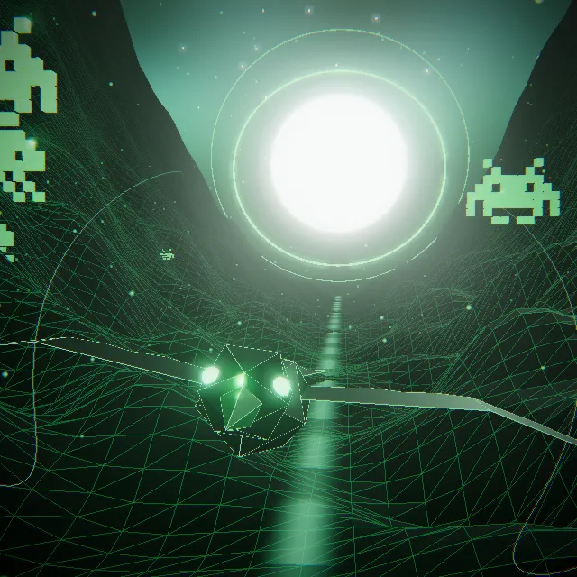
 Real-time 3D · Three.js · rendered from code

</td>

</tr>
</table>

<!-- ========================================================= -->
<!--                WHAT I BUILD                             -->
<!-- ========================================================= -->

  

<!-- ========================================================= -->
<!--                HOW I WORK                               -->
<!-- ========================================================= -->

  

<!-- ========================================================= -->
<!--                AI ENGINEERING                           -->
<!-- ========================================================= -->

  

<!-- ========================================================= -->
<!--                GAME DEVELOPMENT                         -->
<!-- ========================================================= -->

  

<!-- ========================================================= -->
<!--                SYSTEM ARCHITECTURE                      -->
<!-- ========================================================= -->

  

<!-- ========================================================= -->
<!--                SELECTED WORK                            -->
<!-- ========================================================= -->

  

<a href="https://github.com/Shining-Crow/PocketCare"><b>PocketCare ↗</b></a> &nbsp;·&nbsp; <a href="https://github.com/Shining-Crow/Restaurant"><b>Restaurant ↗</b></a>

<!-- ========================================================= -->
<!--                ACTIVITY                                 -->
<!-- ========================================================= -->

  

<!-- ========================================================= -->
<!--                SHOWREEL                                 -->
<!-- ========================================================= -->

  <a href="assets/video/showreel.mp4">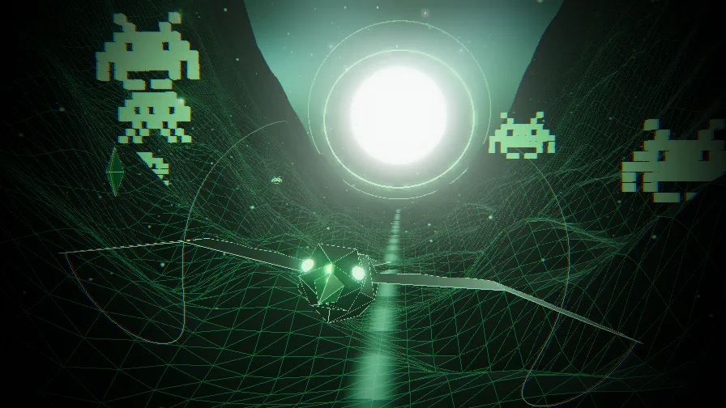</a>
   ▶ Real-time 3D, built with Three.js · click for the full 1080p cinematic

<!-- ========================================================= -->
<!--                LET'S BUILD                              -->
<!-- ========================================================= -->

  <a href="mailto:shiningcrow.dev@gmail.com"></a>

  
  

⚡ Live sections refresh every 6 hours via GitHub Actions · last sync 2026-10-29

