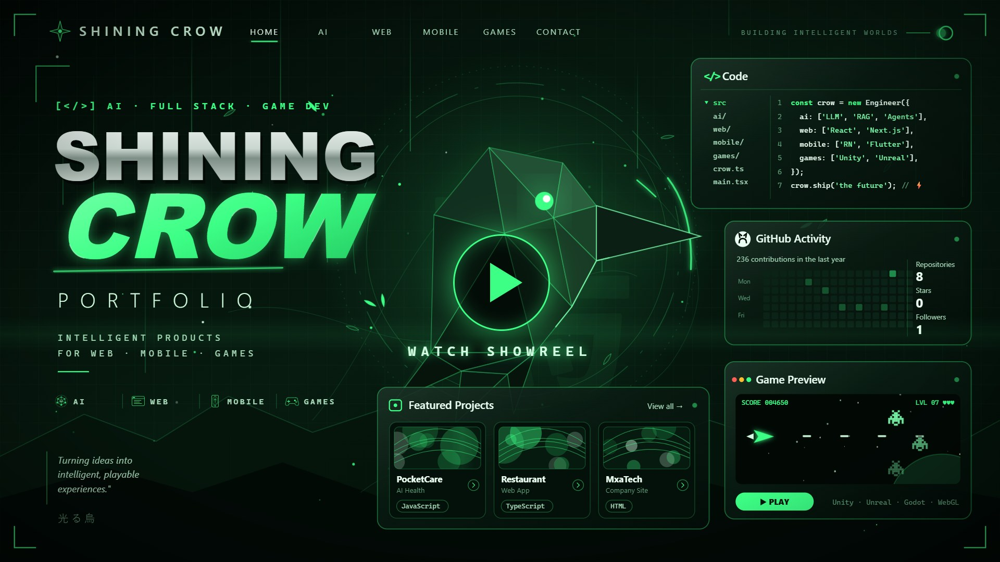

<!-- ⚠️ AUTO-GENERATED by scripts/build.mjs — edit profile.config.json instead. -->

<!-- ========================================================= -->
<!--                PREMIUM HERO                             -->
<!-- ========================================================= -->

  

<!-- ========================================================= -->
<!--                PROFILE INTRO                            -->
<!-- ========================================================= -->

<table align="center" width="96%">
<tr>

<td width="58%" valign="top">

<h2>Intelligence, Engineered to Play</h2>

I'm <strong>Shining Crow</strong>, a Senior AI Full Stack Engineer building across the <strong>AI, web, mobile, and game</strong> layers.

I turn ambitious product ideas into fast, scalable, production-ready systems — and I bring a game developer's obsession with feel, performance, and play to everything I ship.

 

<table>
<tr>
<td>

<strong>AI / ML</strong>  LLM · RAG · Agents · Vision

</td>
<td>

<strong>Web</strong>  React · Next.js · Node.js · TypeScript

</td>
</tr>
<tr>
<td>

<strong>Mobile</strong>  React Native · Flutter · Swift · Kotlin

</td>
<td>

<strong>Games</strong>  Unity · Unreal · Godot · WebGL

</td>
</tr>
</table>

  
  

</td>

<td width="42%" align="center">

</td>

</tr>
</table>

<!-- ========================================================= -->
<!--                TECHNOLOGY UNIVERSE                      -->
<!-- ========================================================= -->

  

<!-- ========================================================= -->
<!--                AI ENGINEERING                           -->
<!-- ========================================================= -->

  

<!-- ========================================================= -->
<!--                GAME DEVELOPMENT                         -->
<!-- ========================================================= -->

  

<!-- ========================================================= -->
<!--                SYSTEM ARCHITECTURE                      -->
<!-- ========================================================= -->

  

<!-- ========================================================= -->
<!--                CONTRIBUTION ACTIVITY                    -->
<!-- ========================================================= -->

  

<!-- ========================================================= -->
<!--                FEATURED PROJECTS                        -->
<!-- ========================================================= -->

  

<a href="https://github.com/Shining-Crow/PocketCare"><b>PocketCare</b></a> &nbsp;·&nbsp; <a href="https://github.com/Shining-Crow/Restaurant"><b>Restaurant</b></a> &nbsp;·&nbsp; <a href="https://github.com/Shining-Crow/MxaTech"><b>MxaTech</b></a> &nbsp;·&nbsp; <a href="https://github.com/Shining-Crow/remote-cooperation"><b>remote-cooperation</b></a>

<!-- ========================================================= -->
<!--                SHOWREEL                                 -->
<!-- ========================================================= -->

  
   ▶ Click to watch the 1080p showreel

<!-- ========================================================= -->
<!--                CONNECT                                  -->
<!-- ========================================================= -->

  

⚡ Slides auto-refresh every 6 hours via GitHub Actions · last sync 2026-10-18

